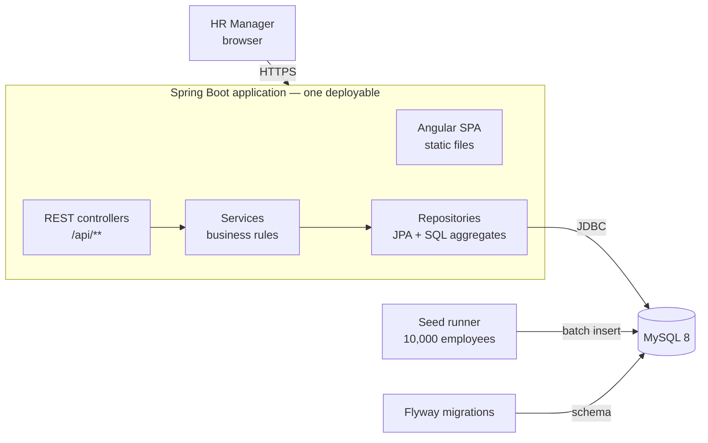
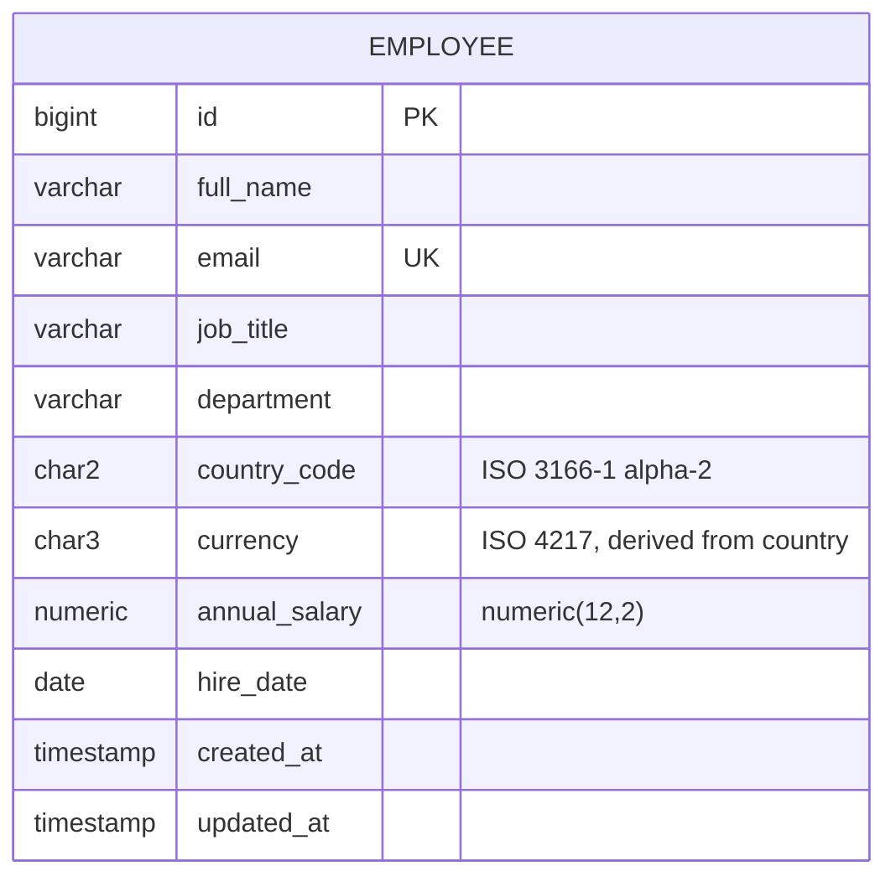

# Architecture

_Design before implementation. Updated as decisions change; see [decisions/](decisions/) for the reasoning behind each choice._

## Overview

A single Spring Boot application serves both the REST API and the built Angular UI, backed by one relational database.



## Tech stack

| Layer | Choice |
|---|---|
| Backend | Java 21, Spring Boot 3, Spring Web, Spring Data JPA, Bean Validation |
| Database | MySQL 8; schema managed by Flyway |
| Frontend | Angular (latest stable), Angular Material |
| Build | Maven wrapper (backend), Angular CLI via npm (frontend) |
| Tests | JUnit 5, AssertJ, Mockito, Spring test slices; Angular's default test runner |
| Deployment | One Docker image on a free-tier host, managed MySQL |

## Repository layout

```
salary_management/
├── backend/     Spring Boot application
├── frontend/    Angular application
├── docs/        requirements, architecture, decisions, plan, AI usage
├── CLAUDE.md    instructions given to the AI assistant
└── README.md
```

## Backend structure

Packaged **by feature**, layered inside each feature:

```
com.acme.salary
├── employee/     Employee entity, repository, service, controller, DTOs
├── insights/     aggregate queries, service, controller, response records
├── seed/         deterministic employee generator + seed runner
└── common/       error handling, country/currency reference data
```

- **Controllers** translate HTTP to service calls; no business logic.
- **Services** hold the rules (validation beyond annotations, currency derivation).
- **Repositories** own persistence; insights use dedicated SQL aggregate queries.
- **DTOs** at the API boundary; entities are never exposed directly.

## Data model



Indexes: `country_code`, `(country_code, job_title)`, `(country_code, department)`, `lower(full_name)` for search.

A single table is enough for the scope. Job titles and departments are plain columns rather than lookup tables; see [ADR 0003](decisions/0003-single-employee-table.md).

## API (initial sketch)

| Method | Path | Purpose |
|---|---|---|
| GET | `/api/employees?search=&country=&jobTitle=&department=&page=&size=&sort=` | Paginated, filtered list |
| GET | `/api/employees/{id}` | One employee |
| POST | `/api/employees` | Create |
| PUT | `/api/employees/{id}` | Update |
| DELETE | `/api/employees/{id}` | Delete |
| GET | `/api/insights/summary` | Headcount overall and per country |
| GET | `/api/insights/countries` | Salary stats per country |
| GET | `/api/insights/countries/{code}/job-titles` | Salary stats per job title in a country |
| GET | `/api/insights/countries/{code}/departments` | Salary stats per department in a country |
| GET | `/api/reference/filters` | Distinct countries, job titles, departments for UI filters |

Errors use a consistent JSON shape (RFC 7807 problem details) with field-level validation messages.

## UI screens

1. **Employees:** table with search, filters, pagination and sorting; add/edit form in a dialog; delete with confirmation.
2. **Insights:** country summary table; select a country to see job title and department breakdowns.

## Performance considerations

- **Pagination on the server.** The list endpoint never returns more than one page (default 20, max 100).
- **Aggregates in SQL.** `GROUP BY` with `MIN/MAX/AVG`, and window functions for the median (MySQL has no median function); the application never loads 10,000 rows to compute statistics.
- **Indexes** match the filter and group-by columns above.
- **Seeding** uses JDBC batch inserts, so 10,000 rows load in seconds.
- At 10,000 rows, caching is not needed. If data grew 100×, the first steps would be caching insight results and a materialised view refreshed on write.
