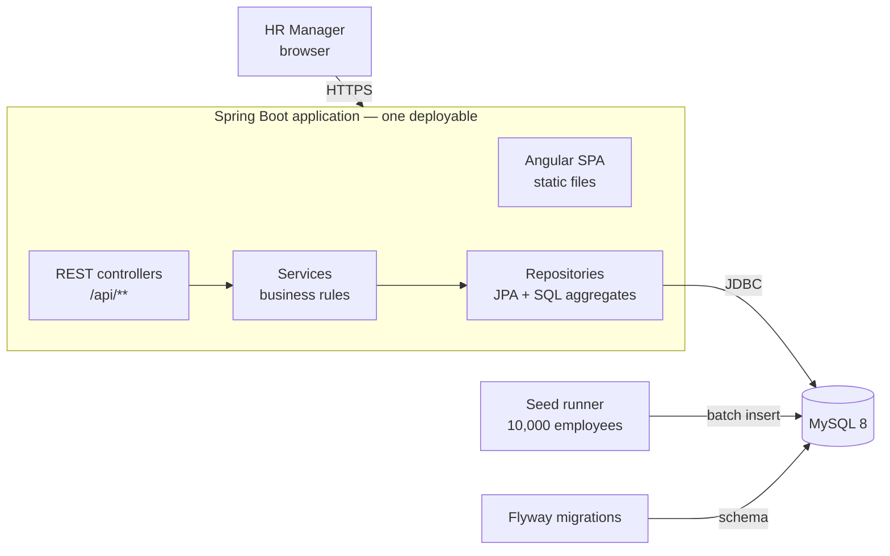
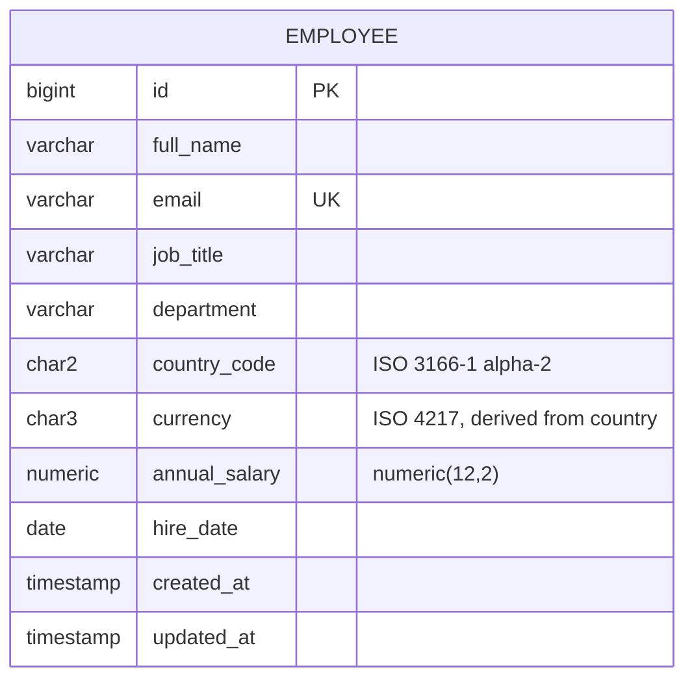

# Architecture

_Design before implementation. Updated as decisions change; see [decisions/](decisions/) for the reasoning behind each choice._

## Overview

A single Spring Boot application serves both the REST API and the built Angular UI, backed by one relational database.



## Tech stack

| Layer | Choice |
|---|---|
| Backend | Java 21, Spring Boot 4, Spring Web MVC, Spring Data JPA, Bean Validation |
| Database | MySQL 8; schema managed by Flyway |
| Frontend | Angular (latest stable), Angular Material |
| Build | Maven wrapper (backend), Angular CLI via npm (frontend) |
| Tests | JUnit 5, AssertJ, Mockito, Spring test slices; Angular's default test runner |
| Deployment | One Docker image on a free-tier host, managed MySQL |

## Repository layout

```
salary_management/
├── backend/     Spring Boot application
├── frontend/    Angular application
├── docs/        requirements, architecture, decisions, plan, AI usage
├── CLAUDE.md    instructions given to the AI assistant
└── README.md
```

## Backend structure

Packaged **by feature**, layered inside each feature:

```
com.acme.salary
├── employee/     Employee entity, repository, service, controller, DTOs
├── insights/     SQL aggregate queries, controller, response records
├── seed/         deterministic employee generator, batch seeder, startup runner
└── common/       error handling, country/currency reference data, paging response
```

- **Controllers** translate HTTP to service calls; no business logic.
- **Services** hold the rules (unique email, no future hire dates). Rules that belong to the data itself live in the entity: currency always follows country, salaries always have two decimal places.
- **Repositories** own persistence; insights use dedicated SQL aggregate queries through `JdbcClient`.
- **Insights have no service layer.** They are read-only queries with no business rules, so a pass-through service would add code without adding behaviour. One would be introduced as soon as a rule appears (for example, hiding groups too small to stay anonymous).
- **DTOs** at the API boundary; entities are never exposed directly.
- **Errors** map from a few generic exception types in `common` (not found, invalid request, conflict), so the error handler does not depend on any feature.

## Data model



Indexes: `(country_code, job_title)` and `(country_code, department)` serve country filters and insight grouping (their leading column also covers country-only queries); `full_name` serves name search. The `utf8mb4_unicode_ci` collation makes comparisons case-insensitive, so no `lower()` index is needed. A `CHECK` constraint keeps salaries positive at the database level too.

A single table is enough for the scope. Job titles and departments are plain columns rather than lookup tables; see [ADR 0003](decisions/0003-single-employee-table.md).

## API

| Method | Path | Purpose |
|---|---|---|
| GET | `/api/employees?search=&country=&jobTitle=&department=&page=&size=&sort=` | Paginated, filtered list (default 20 per page sorted by name, max 100) |
| GET | `/api/employees/filter-options` | Supported countries (with currency), job titles and departments in use |
| GET | `/api/employees/{id}` | One employee |
| POST | `/api/employees` | Create (201 with `Location`) |
| PUT | `/api/employees/{id}` | Update |
| DELETE | `/api/employees/{id}` | Delete (204) |
| GET | `/api/insights/countries` | Headcount, min, max, average, median and total payroll per country |
| GET | `/api/insights/countries/{code}/job-titles` | The same statistics per job title within a country |
| GET | `/api/insights/countries/{code}/departments` | The same statistics per department within a country |

Changes from the initial sketch: the separate `/api/insights/summary` endpoint was dropped because per-country headcounts already answer it (the UI sums them for the org total), and filter values moved to `/api/employees/filter-options` because they belong to the employee list.

Errors use a consistent JSON shape (RFC 7807 problem details): 400 for invalid input (with an `errors` map per field), 404 for unknown employees, 409 for duplicate emails.

## Frontend structure

Angular 22 with standalone components, signals and Angular Material, organised by feature to mirror the backend:

```
frontend/src/app
├── employees/   list page, form dialog, API client, models
├── insights/    insights page, API client, models
└── shared/      confirmation dialog
```

- **State** lives in signals. Server data is loaded with `rxResource`, which tracks loading and errors and reloads when its parameters (the list query, the selected country) change.
- **Each page loads lazily**, so the Employees page's table and form code is not downloaded until it is opened.
- **The selected country is in the URL** (`/insights/IN`), so a breakdown can be bookmarked; Spring Boot forwards these routes to `index.html`.
- **Server validation** messages from the API's `errors` map are shown on the matching form fields.
- **Tests** drive components through Angular Material's component harnesses against fake API clients, so they read like a user's actions and need no server.

## UI screens

1. **Employees:** table with search, filters, pagination and sorting; add/edit form in a dialog; delete with confirmation.
2. **Insights:** country summary table; select a country to see job title and department breakdowns, each with a range bar.

## Performance considerations

- **Pagination on the server.** The list endpoint never returns more than one page (default 20, max 100).
- **Aggregates in SQL.** `GROUP BY` with `MIN/MAX/AVG`, and window functions for the median (MySQL has no median function); the application never loads 10,000 rows to compute statistics.
- **Indexes** match the filter and group-by columns above.
- **Seeding** uses JDBC batch inserts, so 10,000 rows load in seconds.
- At 10,000 rows, caching is not needed. If data grew 100×, the first steps would be caching insight results and a materialised view refreshed on write.
